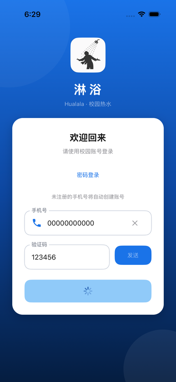
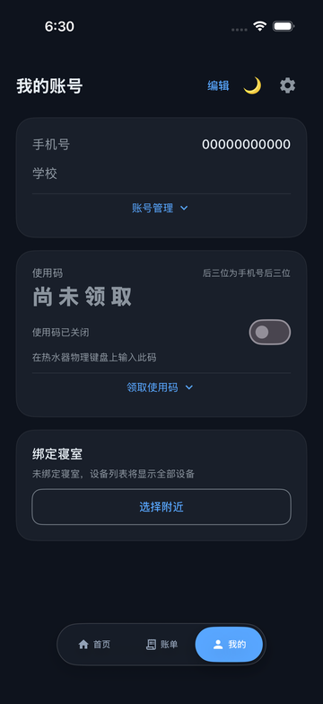
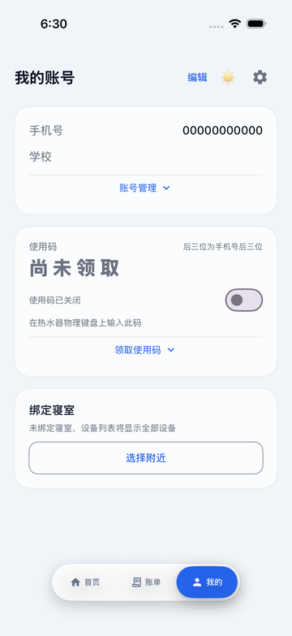

# LinYu iOS 0.4.6（10）实际质量检查结果

维护者：Cra3y。Android 原作者：yehu-imei。日期：2026-11-06。

**发布判定：阻断。没有生成新 IPA，没有创建 GitHub Release，没有覆盖默认分支或稳定制品。**正式工作流在 iOS UI 测试阶段失败，按要求未执行后续真机 build、ad-hoc 签名和 IPA 打包。本轮一次正式构建额度已经使用，后续代码修正不能被视为已经通过运行验证；不得自动重试。

## 固定源码与分支完整性

- 最终整合分支：`release/0.4.6-20261106`。
- 实际运行测试的完整 SHA：`f3434949f1c23aac5eb1f3135ceee8527e53934a`。
- 测试失败后的代码修正：`24f667a2e4f7ea81990d1ae47284011c17d03aca`。仅静态检查通过，**未在 Xcode 编译或运行**。
- App / Widget 配置均为 **0.4.6（Build 10）**，最低 iOS/iPadOS 16.0。名称「淋浴」、图标和 Bundle Identifier 不变。
- 最近成功 IPA 仍为 **0.4.5（Build 9）**，源码 `c6d6c3302aa92161cd6ff48656a671cbbcf47de5`，不是本次候选的新制品。
- 仓库已为 Public，默认分支仍为 `main`（0.4.4 / 8）。未把失败候选合并到默认分支，未修改稳定历史。

重新 fetch 并核实 `ui/android-parity`、`fix/ble-settlement-recovery`、`fix/closed-meter-recovery-ui-20261106`、`fix/nearby-device-names-20261106`、`fix/theme-safe-area-transition-20261106`、`fix/background-management-20261106`、`main`、旧 `build/livecontainer` 的远端末端，全部是本分支祖先。合并采用正常历史，没有用旧打包分支覆盖新修复。

Android 固定基准为 v3.1.0（`761ae9b51bb0168b5a4de63a91f5168328107234`）。完整 Android → iOS 模块、调用链、分支末端和平台差异见 [构建前清单](0.4.6-readiness.md) 及 [原版模块映射](../ui-parity/ANDROID_IOS_MAP.md)。本报告补充实际执行结果，不能把源码审查等同于真实硬件验收。

## 本轮确认的缺陷与修复

| 确认的问题 | 修复位置 / 原版依据 | 结果与边界 |
| --- | --- | --- |
| 云端结算时间回退可能匹配其他设备、其他订单；失败响应或身份冲突仍可能采纳金额 | `SettlementBillMatcher.swift`、`CloudShowerController.swift`；对照 Android `data/SettlementEngine.kt::matchBill` | orderNo / orderId 优先，拒绝重复和设备冲突；时间回退限定同设备、可靠本地单号、唯一候选及本次时间窗；要求服务端 success。8 项纯核心匹配测试和 21 项云端测试通过。此收紧是避免错归账的安全差异 |
| `Decimal` 可把 `40pending` 等字符串前缀当金额 | `CloudShowerController.swift` | 先验证完整有限数值，再按原单位转换；非法金额保留待核实。解析断言通过 |
| 跨月历史云端订单只查当前月，可能漏查 | 同上；对照原版账单查询与匹配调用链 | 先查订单月份，再兼容当前月；不增加消费上传/扣费请求。跨月及矛盾响应回归通过 |
| iOS Widget 整个主体指向 start/stop，与原版点击主体打开 App 不同 | `Shared/LinYuWidgetSnapshot.swift`、`LinYuWidgets.swift`；Android `widget/WidgetRenderer.kt` | 主体改为只读 show，显式操作 Link 保留；集成用例通过。LiveContainer 不含扩展，常规签名 Widget 尚未实装验证 |
| 扩展版本落后、应用信息只有 Android 版本 | 两份 Info.plist、`ProfileReleases.swift` | 主/扩展版本一致，显示真实 Bundle iOS 版本与自身 Releases，保留 Android 参考信息 |
| 浅色主题恢复后按钮仍处于 Disabled，必须重建页面才恢复 | `LinYuThemeHost.swift`；Android `CircularRevealTheme.kt` / `Theme.kt` | 普通 Environment 只传递对象引用，按钮没有直接订阅解锁通知；拆出显式 `@ObservedObject` 的按钮。650ms、曲线、遮罩与页面状态保留。后续修正 **未运行验证** |
| 慢登录 UI 测试固定 6 秒响应，截图及第二次点击期间已跳转首页，导致查找旧按钮失败 | `LoginFeedbackFixture.swift`、`LoginVisualTests.swift` | Simulator-only Mock 使用显式放行响应，保留真实 loading / 禁用 / 重复点击断言；不修改真实认证或增加真实登录延迟。后续修正 **未运行验证** |
| 横屏用例在旋转前首次 phone.tap 就报告 not hittable | `LoginVisualTests.swift` | 加入正常滚动寻找输入控件，并继续要求 isHittable；失败仍 XCTFail，不按坐标绕过。**原始不可点击原因尚未完全证明，不能宣称已修复**；需重新运行并检查实际画面 |

本轮没有修改 BLE 指令、结算上传/写回顺序、登录 API、会话安全存储或后台业务。本轮对云端账单的更改全部用于只读核实结果，不会因为未知状态自动补发可能记账的请求。

## 自动化实际执行结果

[Ubuntu-only 预检 42172837901](https://github.com/CarpediemDyn/linyu-ios/actions/runs/42172837901) 成功，不分配 Mac、不生成 IPA。[唯一正式工作流 42173058772](https://github.com/CarpediemDyn/linyu-ios/actions/runs/42173058772) 失败。两次均固定同一个 `f343494`，未并发启动多个正式构建。

| 检查 | 实际结果 |
| --- | --- |
| 固定 SHA、版本、资源、许可证预检 | 通过；51 个 catalog、67 个资源引用、45 个 SVG 来源哈希、AppIcon 尺寸/alpha、主扩展版本 |
| Ubuntu CoreTests | 51/51 通过，包括 43 项交易状态机和 8 项账单匹配 |
| macOS CoreTests | 51/51 通过 |
| Python 打包测试（Ubuntu/macOS） | 8/8 通过，包括 POSIX 符号链接用例；这是打包逻辑测试，不是新 IPA 验证 |
| iOS 模拟器编译 | App、单元测试和 UI 测试目标成功编译；不能证明 arm64 真机包已构建 |
| iOS 单元测试 | **177/177 通过，0 失败**；已经包含上述 51 项 CoreTests，不能重复加总为独立用例 |
| iOS UI 测试 | **8 项执行，5 通过，3 失败**；发布闸门未通过 |
| 真机 App build、签名、IPA | 未执行，受 UI 测试闸门阻止 |
| 发布与下载 | 未创建 Release，没有新的 IPA 下载链接、IPA SHA-256 或签名验证报告 |
| 失败后本地轻量验证 | 69 个 Swift 文件 tree-sitter 语法解析、资源预检、git diff --check 通过；Windows 打包 7 通过、1 POSIX 用例跳过。不是 Swift 类型检查，也不是修正后运行通过 |

177 项单元测试构成：BackgroundManagement 22、BleProtocol 5、CloudShower 21、NearbyMeterNameResolver 14、OriginalFeatureAPI 17、OriginalIntegration 10、ProfileVisual 1、QzxyAPI 24、ResponsiveVisual 3、SettlementBillMatcher 8、ThemeReveal 4、VisualComponent 1、WalletShowerVisual 2、WaterTransaction 43、WriteBackCrypto 2。

通过的 5 项 UI 用例：`testFailedMockLoginRestoresButton`、`testFastAndOrdinaryMockLoginReachHome`、`testLoginIsDisabledWhileSMSRequestIsInFlight`、`testLoginModesAndInvalidPhone`、`testLegacyRecoveryChecksBillsOfflineWithoutAnIncreasingTimer`。

失败的 3 项：

1. `testLandscapeLoginActionRemainsReachableWithKeyboard`：旋转前首次手机号输入框点击失败。层级中输入框存在且 frame 在页面内，缺少可信 hit point。不能仅凭坐标正常就认定没有 UI 缺陷。
2. `testSlowMockLoginShowsDisabledLoadingAndReachesHome`：loading 与禁用断言、截图已经成功，第二次点击时真实视图已经进入首页，旧按钮消失。确认是测试与 Mock 响应时序竞争。
3. `testBothThemeDirectionsKeepNavigationAndSelectedPagesAccessible`：浅→深成功，深→浅颜色已变，但 value 为「浅色」的按钮仍 Disabled，等待解锁超时。已有可访问性层级与截图证据；原断言及超时没有被放宽或删除。

没有跳过失败用例、添加 continue-on-error 或以单元测试成功替代 UI 验收。日志还含已有的 MTKViewDelegate 注解、模拟器 ImageIO/CA 及截图宿主 appearance 警告，不能声称构建完全无警告。

## 全功能审查状态

| 模块 | 已核查 / 运行证据 | 尚缺的验收 |
| --- | --- | --- |
| 登录、短信、账号与会话 | 原版调用链、单次提交、即时状态、sending 条件、Mock 网络/错误及普通快响应 UI；24 项 API 测试通过 | 慢响应修正后 UI、横屏输入可点击、真短信/异地会话/Keychain 与宿主升级 |
| BLE 扫描与自动名称 | 只读串行身份读取、UUID→真实身份→台账、账户隔离缓存、手动优先；14 项名称与 5 项协议测试通过 | 447/450 等真实广播首次识别、弱信号、权限、无线电重连与多设备同时发现 |
| 开关阀、消费及历史恢复 | 43 项核心覆盖 ACK、未知结果、关闭证据、冻结计时、采集/上传/写回失败、重启、设备/账户隔离；旧单恢复 UI 通过 | 真实固件/服务器结果、原手机旧日志升级、断线/后台挂起后恢复；自动测试不产生真实消费 |
| 云端控制、钱包与账单 | 21 项云端、17 项 Feature API、10 项集成及金额匹配回归通过 | 真实余额/欠费/账单同步及服务端延迟；Mock 耗时不代表真实加速 |
| 背景装扮 | 22 项通过，含 HOME/SHOWER 隔离、导入竞态、持久化迁移、HEIC/EXIF/大图、缓存与 GPU 方向/alpha | iCloud 下载、LiveContainer 文件路径/图片选择、滑块 FPS/内存、实际 Crop 观感 |
| 主题、安全区域与导航 | 4 项绘制测试通过，静态深浅截图导航完整；按钮解锁缺陷已修源码 | 修正后双向/连续切换、动画开始/中间帧、状态栏、LiveContainer 窗口、安全区与自定义图组合 |
| 通知与 Widget | 共用使用/未知/结算状态语义、点击主体只打开、明确控制入口；只读链接集成断言通过 | 独立签名/App Group/WidgetKit 实装、通知权限及宿主能力；LC 包不含 Widget |
| 布局、扫码与辅助页面 | 窗口宽度约束、可滚动布局、渲染/组件测试通过，有登录/个人中心/钱包/用水/窄窗等附件 | 横屏登录失败未解决验收；摄像头/相册、iPad 分屏/窗口、小大屏真机；Duo/折叠形态没有对应硬件结论 |

以上均明确区分源码审查、Mock/渲染测试与真实设备验收。没有真实服务器/水表操作，没有假称所有功能无 Bug。主要历史安全场景见核心测试；不能把这些结果当作 447 和 450 已完成实际清账的证明。

## 本次实际截图

以下为失败运行 `f343494` 导出的 Mock 模拟器画面，缩小用于展示。它们证明特定时刻的实际呈现，不证明整段动画无掉帧，也不是后续修正已通过的截图。

| 登录 loading | 深色主题 | 浅色已显示、按钮仍 Disabled |
| --- | --- | --- |
|  |  |  |

完整 XCTest 与截图/界面层级附件保留在上述正式运行的 `LinYu-LiveContainer-XCTest` 和 [LinYu-iOS-Visual-Checks](https://github.com/CarpediemDyn/linyu-ios/actions/runs/42173058772/artifacts/13482772781) 中；遵循 GitHub 制品保留期限。

## 安全、许可证及平台限制

- 全分支/可达历史复扫未发现新增用户凭据。Gitleaks 的两项既有命中已分别核对为公开协议常量、journal 存储键名，不是用户 Token；没有通过全局忽略掩盖它们。两份新 CI 完整文本日志扫描均 0 命中。
- 未跟踪私钥、证书、provisioning、真实账户交易导出或 IPA。GitHub Secrets、Variables、Environments、Deploy Keys 检查均为 0。安全工具只能提供已执行范围的检查证据，不能保证未来内容绝对没有秘密。
- MIT 原作者版权、Cra3y 移植维护署名、Material Icons Apache-2.0 和既有资源来源声明保留；未增加运行时第三方依赖或外部图片。
- Core Bluetooth 不提供扫描 MAC；首次自动命名需要安全地连接并只读取得自报身份。忙碌、弱信号或交易优先时可能暂留广播名，不猜设备、不后台自动控制。
- iOS 后台不等价于 Android 前台常驻服务；挂起后必须依赖持久恢复，不能保证继续联网/清账。LiveContainer 的通知、Keychain、后台与窗口行为依赖宿主；本包不含 Widget 扩展。
- 650ms 圆形动画采用绘制层而非整页每帧重建，但本次没有 FPS、真实内存或全设备流畅度测量。iPhone/iPad/折叠形态按可用窗口适配不等于已在所有型号验收。

## 下一次允许构建之前

必须先得到新的明确构建授权；不能把本次失败当作“还没用过打包机会”。下一次需固定新的完整 SHA，运行保留的全部 UI/单元/核心测试，确认输入框可点击与主题解锁。若仍失败，继续阻断；不得删测试。

通过全部门槛后才可构建 arm64 设备包、验证实际签名与包结构、生成 SHA-256，并复用同一 IPA 上传测试版 Release。当前没有这些产物，不能填写虚构哈希或下载链接。本任务结束恢复默认禁止自动打包规则。
