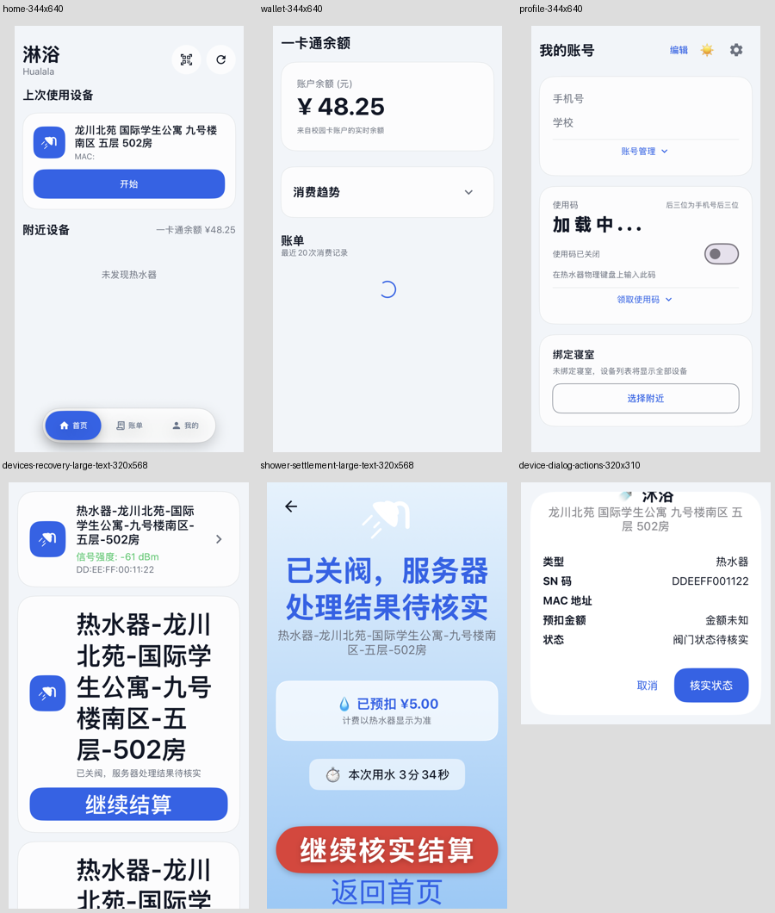
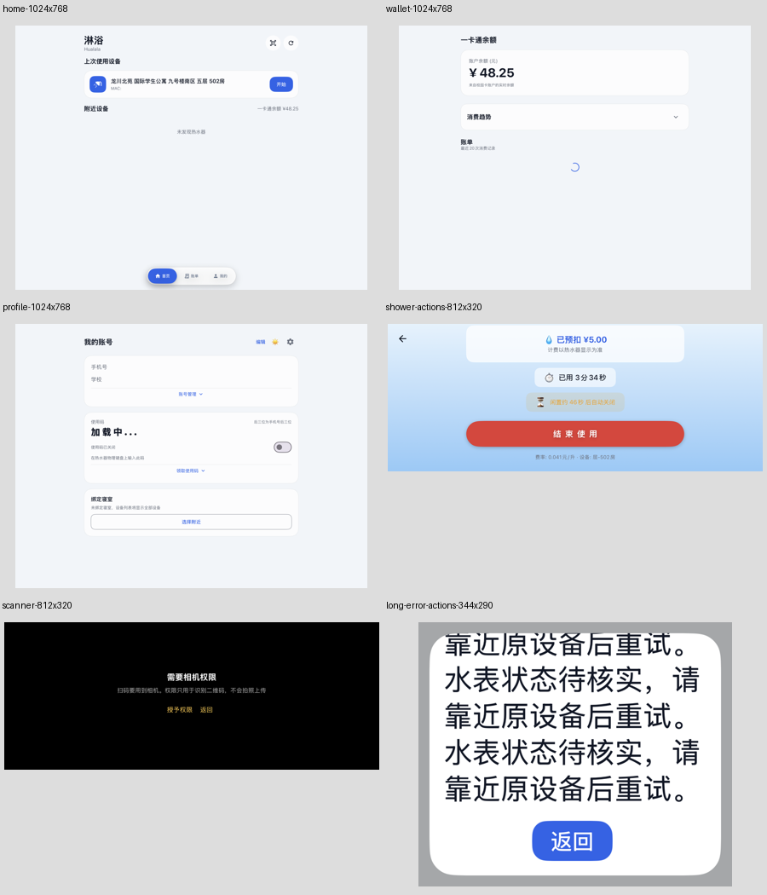
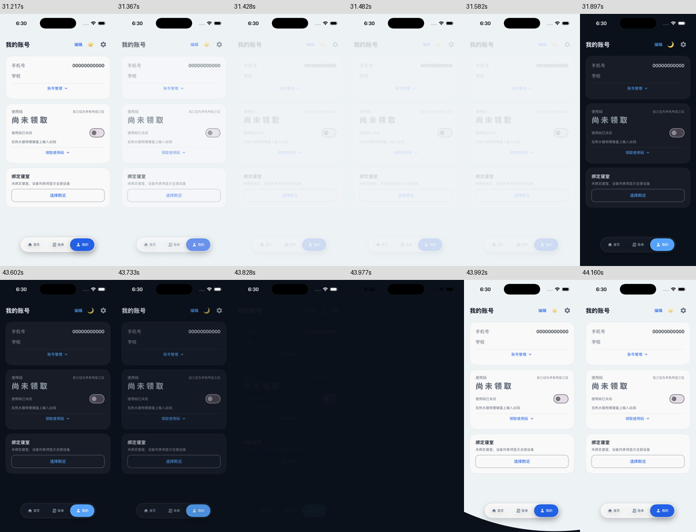
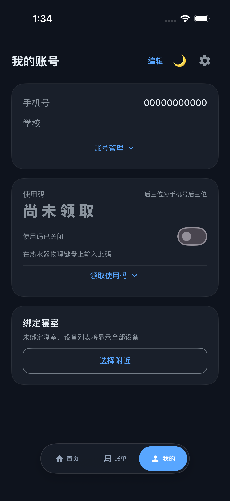
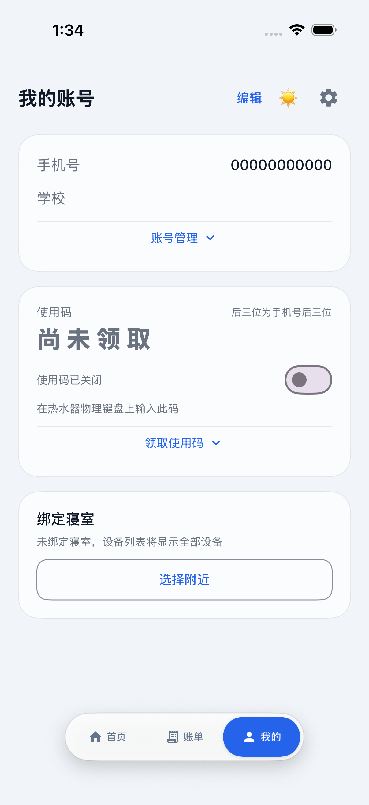

# LinYu iOS 0.4.6（10）继续验证记录

维护者 Cra3y；Android 原作者 yehu-imei。基准 Android v3.1.0（`761ae9b51bb0168b5a4de63a91f5168328107234`）。

**当前仍在验证，尚未放行 IPA 或 Release。用户随后明确本轮暂不适配 iPad，交付范围调整为 iPhone 测试版。**用户在首次构建失败后明确授权继续测试、仅在必要时生成 IPA、完成后创建 Release。以下记录保留失败，不把诊断任务成功当作应用测试通过。

## 历次运行与源码

| 运行 | 固定源码 | 模式及实际结果 |
| --- | --- | --- |
| [42173058772](https://github.com/CarpediemDyn/linyu-ios/actions/runs/42173058772) | f343494 | 首次正式任务；177 单元通过，UI 5/8，测试闸门阻止打包 |
| [42183540880](https://github.com/CarpediemDyn/linyu-ios/actions/runs/42183540880) | dfd8ca2 | iPhone 仅测试；177 单元通过，UI 6/8；主题解锁及慢登录通过，两个初始输入框点击失败 |
| [42186487363](https://github.com/CarpediemDyn/linyu-ios/actions/runs/42186487363) | af973f6 | Intel iPhone 仅测试，触及 35 分钟任务上限；暂存日志证明 177 单元、6 项登录 UI 通过；恢复首次点击失败，主题未完整结束，不能算全量通过 |
| [42192276402](https://github.com/CarpediemDyn/linyu-ios/actions/runs/42192276402) | 2560d18 | 只读诊断，无编译/测试/IPA。旧 xcresult 未封存 Info.plist，标准读取器无法加载；另从 Staging 恢复测试标准输出 |
| [42193212186](https://github.com/CarpediemDyn/linyu-ios/actions/runs/42193212186) | c282afa | Apple Silicon iPhone 仅测试；177 单元通过，UI 7/8；登录与恢复全部通过；主题用例导航按钮即时 hittable 断言失败，约 0.8 秒后同一按钮正常点击，其他双向切换与导航操作继续完成 |
| [42196085083](https://github.com/CarpediemDyn/linyu-ios/actions/runs/42196085083) | e6ee256 | iPad 全量仅测试；177 单元通过、UI 7/8，主题导航与恢复通过；短手机号提交后未观察到错误提示，截图/层级确认输入值为 12 且无错误文本 |
| [42210521116](https://github.com/CarpediemDyn/linyu-ios/actions/runs/42210521116) | c8b70e7 | iPad 输入校验用例重复 3 次、3 次失败；几何稳定等待未解决，不能按偶发问题放行 |
| [42212975540](https://github.com/CarpediemDyn/linyu-ios/actions/runs/42212975540) | 01f357d | Mock 隔离与按压诊断，重复 3 次仍失败；日志只出现短信模式的按压/提交，没有短手机号密码模式的按压或提交，说明失败在认证之前的触控路径 |
| [42215047063](https://github.com/CarpediemDyn/linyu-ios/actions/runs/42215047063) | 9bbb307 | 完整 label 点击形状后的 iPad 定向重复，3/3 仍失败；该改动未解决阻断 |
| [42217790535](https://github.com/CarpediemDyn/linyu-ios/actions/runs/42217790535) | 57a84b9 | 普通点击及可见中心坐标点击各重复 3 次，6 次均失败；一次另有几何就绪失败。未记录到密码模式提交，不能归因于辅助功能点击点 |
| [42220530198](https://github.com/CarpediemDyn/linyu-ios/actions/runs/42220530198) | f2b1654 | 仅模拟器原生窗口 hitTest 路径诊断；用户调整范围后取消，未取得有效触摸路径结果；无认证/蓝牙/结算修改，无 IPA |

| [42221696891](https://github.com/CarpediemDyn/linyu-ios/actions/runs/42221696891) | 6de07d1 | iPhone 完整仅测试：177 单元、6 登录 UI、历史恢复 UI 均通过；主题 UI 导航 hittable 等待失败，未生成 IPA |

| [42224770638](https://github.com/CarpediemDyn/linyu-ios/actions/runs/42224770638) | e3c1571 | iPhone 完整仅测试成功：177 单元、全部 8 UI、51 Core 与 8 打包均通过；无 IPA |

每次完整预检仍包含 51 项 CoreTests 与 8 项 Python 打包测试。iOS 的 177 项单元测试已经包含这 51 项核心测试，不能重复相加为独立用例。全部运行使用 Mock 网络/水表，不控制真实校园设备或产生消费。

## 确认的缺陷与后续修正

1. **云端账单身份和金额核实**（`f343494`）：拒绝跨设备、跨订单和歧义候选，要求 success，拒绝非法金额前缀；跨月恢复先查询原订单月份。8 项匹配回归与 21 项云端回归均已通过。保留未知结果，不增加上传或扣费请求。
2. **Widget 主体误触及版本**（`f343494`）：主体链接对应原版打开应用，仅显式操作入口保留控制；主/扩展版本均 0.4.6（10）。LC 不嵌入扩展，普通签名 Widget 仍待实装。
3. **主题按钮未解锁**（`24f667a`）：Environment 只传引用而不订阅对象更新，改为按钮显式观察 reveal 对象。保留原 650ms 遮罩、曲线与页面状态；后续双向 UI 已证明能够重新点击。
4. **慢登录测试时序竞争**（`24f667a`）：固定 6 秒 Mock 响应可能在截图/重复点击之前跳到首页，改为 simulator-only 手动放行。真实认证、网络参数、安全存储和跳转速度未改；相应用例后续通过。
5. **登录输入的辅助功能重叠与触控区域**（`af973f6`）：浮动标签以独立 StaticText 覆盖空输入控件的区域，和原版 Material 输入框统一标签语义不同。保留可见标签，由输入框提供完整辅助功能名称，扩大原生输入区域至至少 44pt；6 项登录 UI 在 Intel 和 Apple Silicon 后续运行均通过。
6. **测试点击时机**（`c282afa` / `e6ee256`）：恢复入口及导航在状态更新/动画期间仅 exists 不代表 enabled / hittable。采用有上限的状态等待，保留实际点击、阀门未知、服务器记账、另一设备隔离、不增长计时、导航边界等全部断言；不按坐标绕过控件，不增加真实业务延时。
7. **CI 诊断丢失与模拟器启动**（`2560d18` / `c282afa`）：旧任务超时后未产生可下载普通日志，结果包未封存。加入带 pipefail 的独立 Xcode 控制台制品、明确模拟器 bootstatus 阶段和只读检查模式；CI 上限改为 50 分钟以容纳慢启动，应用 API / BLE 超时未改。
8. **iPad 输入校验的点击诊断**（`c8b70e7`）：已有失败画面证实手机号为 12、按钮可用但错误文本未出现。先校验实际输入值并等待按钮几何位置稳定，再执行一次点击；原错误断言保留。不以自动重试点击掩盖失败。新增定向模式仅用于测试定位；正式 IPA 模式强制忽略定向范围并执行全部测试。
9. **按钮完整点击区域**（`9bbb307`，已证实未解决 iPad 阻断）：三次按压诊断排除了后台认证、网络与单纯等待问题。原版 Material Button 为整块 52dp 区域，导航 Box 的整格设置 clickable；iOS 的部分 shape/尺寸在 ButtonStyle 或 Button 外层，AX 中部分控件也仅有文字尺寸。将点击形状移入真实 label，给登录、发送、模式切换、清空与导航格明确区域；纯描边不参与触控。布局、配色、认证和业务回调不变。

原版对应及差异分类见 [构建前完整映射](0.4.6-readiness.md)、[首次实际结果](0.4.6-quality-results.md)。不能把测试准备改动描述为服务端、蓝牙性能改进。

## 功能审查范围与证据

| 功能 | 已核查 / 已有运行证据 | 尚需真实环境 |
| --- | --- | --- |
| 登录、短信、会话、账号 | 原版 AuthRepository / LoginViewModel 映射；24 API、17 Feature API、6 项登录 UI（临时坐标对照已移除；普通点击回归保留）；输入校验、加载、单次提交、失败恢复 | 真实短信、校园服务失效、账号切换、Keychain / 宿主升级 |
| 扫描与真实名称 | 14 名称、5 协议测试；UUID 连接后只读 0x23 → 台账、串行、账户/TTL 隔离、手动优先 | 实际 447/450、弱信号、多设备、权限与无线电重连 |
| BLE 开关阀与结算 | 43 核心测试：ACK、未知结果、关闭证据、冻结计时、采集/上传/写回失败、重启与账户/设备隔离；恢复 UI 已通过 | 原手机旧数据升级、真实水表固件、网络断开、旧账核实/设备写回 |
| 云端、钱包与账单 | 21 Cloud、8 Matcher、17 Feature API、10 Integration；订单/设备冲突、有限金额、跨月、余额与账单模型 | 真实余额、欠费、账单同步和服务器延迟 |
| 背景装扮 | 22 专项：双作用域、持久化迁移、HEIC/EXIF/大图、竞态、缓存、GPU 方向/alpha；预览与页面共用渲染器 | iCloud 下载、LC 图片路径、实际内存与滑块 FPS |
| 主题、安全区域与导航 | 4 绘制测试；双向主题、解锁及多页实际操作；已有静态和中间帧证据 | 真实状态栏、Home Indicator、LC 窗口和 FPS |
| 通知与 Widget | 账户/订单语义共用；点击主体只打开、显式控制；集成断言覆盖 | LC 权限/后台限制；普通签名扩展与 App Group 未在本包实装 |
| 布局、扫码和辅助页 | 320–1180pt 等窗口渲染、横屏、大字体、滚动按钮、对话框；已人工查看窄/宽屏关键画面 | iPad 校验交互用例尚未通过全量；真实相机/相册、分屏、折叠形态及各型号验收 |

完整 177 项构成：Background 22、BLE 5、Cloud 21、NearbyNames 14、FeatureAPI 17、Integration 10、ProfileVisual 1、QzxyAPI 24、ResponsiveVisual 3、Matcher 8、ThemeReveal 4、VisualComponent 1、WalletShowerVisual 2、WaterTransaction 43、WriteBackCrypto 2。

## 画面证据的边界

窄/宽窗口拼图来自 `dfd8ca2` 的真实 Mock 渲染；后续点击区域与测试同步修正保留了所示布局和绘制参数。不把加载中钱包截图当作已验收所有账单内容。长内容需要正常滚动。

圆形动画拼图取自 `f343494` 首次失败运行中的原始录像，绘制器 `LinYuRevealDrawing.swift` 后续未变。它展示特定录制帧中的底部背景/导航，没有插帧；录屏为可变帧率，不能用来断言真实 App FPS 或没有掉帧。当前按钮解锁以更新后的 UI 测试结果为准。

## 安全与发布规则

- 新提交历史复扫无新增凭据；两项既有命中分别为公开协议常量与 journal 键名，已人工核实；没有新增全局忽略。已取得的新 CI / 暂存标准输出日志扫描无命中。
- 保留 MIT、原作者、Cra3y 维护署名及 Material Icons / 原始资源声明。截图均为 Mock；未发布真实账户、订单导出、证书、私钥或完整敏感报文。
- 默认 `main` 与既有成功 0.4.5（9）制品保留；完整候选在 `release/0.4.6-20261106`，不以旧 build/livecontainer 打包。
- 测试未通过不生成 IPA。仅测试任务跳过 device build、签名、打包和 IPA 上传；诊断任务不执行应用测试，不可算作验证成功。
- 全量通过后固定源码，最终任务再次执行完整测试才进入设备 build。下载后检查 architecture / Info.plist / AppIcon / 签名 / ZIP CRC / 成员哈希 / 来源 SHA / IPA SHA-256，再复用同一包创建测试版 Release。
- iOS 后台不等于 Android 常驻服务；Core Bluetooth 无扫描 MAC；LC 包无 Widget，通知与 Keychain 能力受宿主限制。没有真实设备或测量数据的项目明确保留待验。
- 完成后恢复默认禁止自动打包规则。

## 本轮交付范围调整

用户明确要求暂不适配 iPad。保留已有宽屏布局，但本次不承诺 iPad、分屏及折叠窗口支持；已复现的 iPad 密码模式提交问题未解决，会在 Release 明示。不是把失败记录改为通过。移除 simulator-only 原生触摸/按压日志及临时坐标对照；普通点击、输入校验、快慢登录、失败恢复、禁用/防重复、横屏、主题与结算恢复断言全部保留，在 iPhone 执行完整测试。

## iPhone 导航的后续修正（完整预检通过）

42221696891 的失败截图显示胶囊完整、没有被裁切；AX 层级却将 261×53pt 的装饰层置于三个按钮之后，按钮存在、尺寸正常但 hittable 持续为 false。不能仅按动画等待问题放行。对照原版 FloatingPillNavBar.kt：Surface 的填充、描边与阴影位于 clickable Row 背后。本次把 iOS 整体描边/阴影统一移入 background，并对整棵装饰子树禁止触摸和辅助功能；保留按钮尺寸、点击形状、回调和全部测试断言。42224770638 已通过原先失败的可点击断言、双向主题及全部导航/设置操作。最终固定源码另加强实际页面切换断言；正式任务必须再次全量通过，才可打包。

### 最新实际画面

已人工检查 e3c1571 的深浅个人中心终态：全屏背景完整、胶囊和文字未裁切。即时切页附件中有动画中间帧，不把这些中间帧当成布局终态或 FPS 测量。

| 深色 | 浅色 |
| --- | --- |
|  |  |
